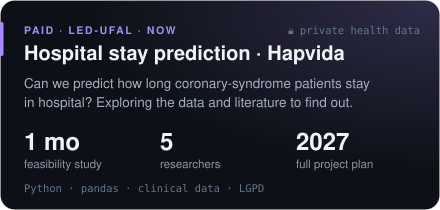
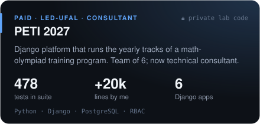
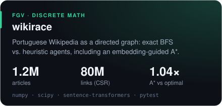
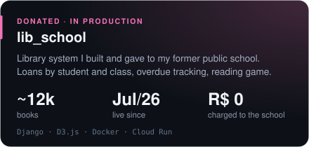

  
  
  
  

I'm 18 and study **Data Science & AI at FGV EMAp**. At **LED-UFAL**, a research lab at the Federal University of Alagoas, I'm a paid researcher on a pilot with **Hapvida**. On my own I built **[medalhas.online](https://medalhas.online)**. I like owning the whole thing: the data, the backend, the deploy and the product calls in between.

---

## 🥇 medalhas.online

**Every Brazilian science-olympiad medalist in one place.** OBMEP, OBM, OBI, IMO and 19 more, from 1979 to today, gathered from the official lists that are scattered across dozens of sites and PDFs.

- figures out which awards belong to the same student **without any ID** (no CPF, no birth date)
- public **API** with no key, OpenAPI 3.1 and rate limiting
- Python stdlib server, hexagonal architecture, **Cloud Run** · 132 tests

  

 

---

## 🔬 What else I work on

  
  
  
  

<b>More projects</b>

 

| Project | What it is |
|---|---|
| **NLP for the State Court of Accounts** | Paid NLP work at LED-UFAL (Oct–Nov 2026): extracted 10.5k personnel acts from 85k pages of Alagoas' Official Gazette (PyMuPDF, selective OCR) and benchmarked 10 text representations for job-title similarity (best AUC 0.80). |
| **SigmaChallenge / Olimpo** | Paid back-end work (NES · SigmaCamp Brazil): custom application forms with Markdown/LaTeX, uploads, e-mails and CSV/ZIP export, plus a RAG support bot on Gemini. Selection for ETAPA SigmaCamp and SigmaFestival Nordeste. |
| **[Quando a chuva vira problema](https://github.com/PedroVNeves/Quando_a_chuva_vira_problema)** | 29M rain-gauge readings crossed with Rio's emergency-center incidents and neighborhoods (FGV, team of 2). |
| **[RAG_Local](https://github.com/PedroVNeves/RAG_Local)** | Fully local RAG: Llama 3, LangChain and ChromaDB on a 6 GB GPU. |
| **[Realtime Emotion Detection](https://github.com/PedroVNeves/Realtime-Emotion-Detection)** | CNN that classifies 7 facial emotions from the webcam (88% on CK+). |

---

## 🧰 Stack

  

**NLP & ML:** sentence-transformers · BERTimbau · gensim · scikit-learn · Keras/PyTorch · RAG (LangChain, ChromaDB, Gemini) · PyMuPDF · OCR

## 🏅 Off the keyboard

- **OBMEP:** National Silver + Regional Gold in 2024 and 2025 · National Bronze in 2022 · Honorable Mention in 2023 · **OAM** Silver
- Alum of **NES**, a free academic-excellence program at UFAL (AI, linear algebra, graph theory, neural networks)
- Exchange student in England through *Daqui Pra o Mundo* · English **C1** certified

Got a correction for medalhas.online, or want to talk? <a href="mailto:pedro.vasconcelosneves@gmail.com">Write me.</a>

